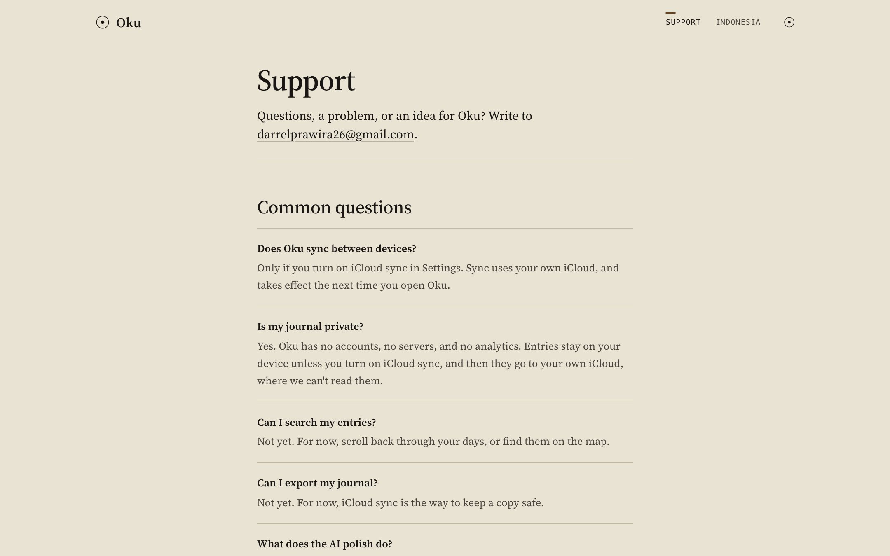
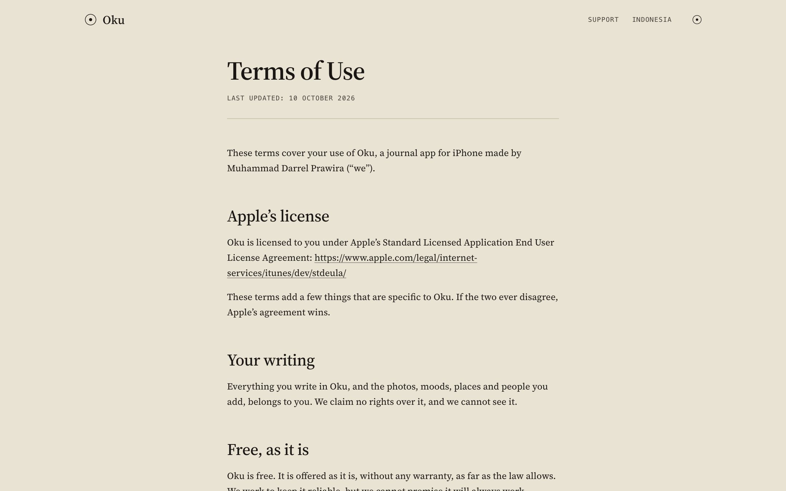
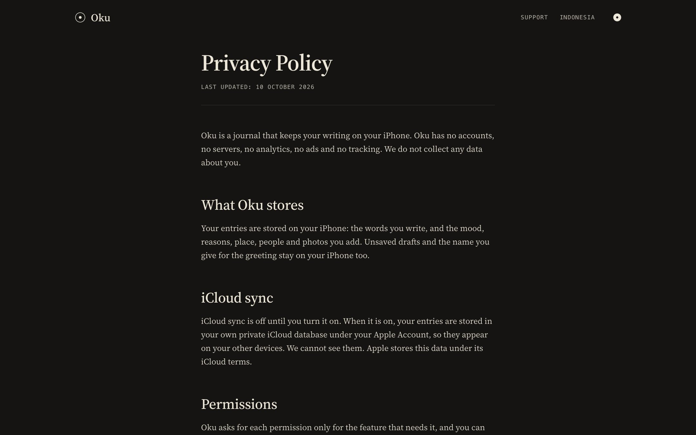
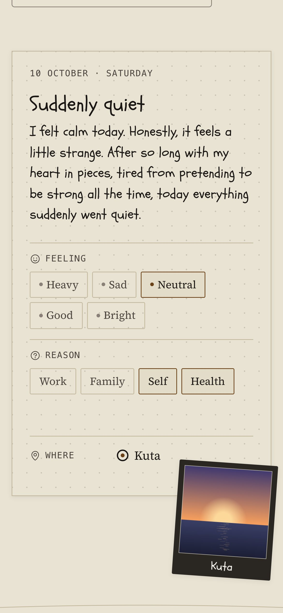
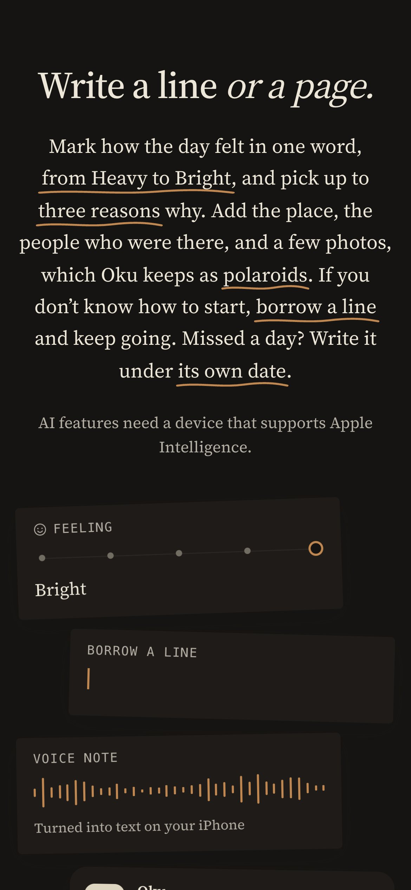

<div align="center">


# Oku

**A quiet place for your days. The website for a journal for iPhone.**

[Live site](https://oku-journal.pages.dev) · App Store: coming soon

</div>

Oku (奥) is named for the inner, hidden part of a place. You write a line or a page, mark how
the day felt, and look back on where your days happened. Everything stays on your iPhone.
This is the site that goes with the app: an introduction, the privacy policy, the terms, and
support.

<p align="center">
  
</p>

<table>
  <tr>
    <td width="50%"></td>
    <td width="50%"></td>
  </tr>
  <tr>
    <td></td>
    <td></td>
  </tr>
  <tr>
    <td></td>
    <td></td>
  </tr>
  <tr>
    <td></td>
    <td></td>
  </tr>
</table>

<table>
  <tr>
    <td width="25%"></td>
    <td width="25%"></td>
    <td width="25%"></td>
    <td width="25%"></td>
  </tr>
</table>

---

## How it's made

- **[Astro](https://astro.build)**, fully static. No client framework; the landing's motion
  is CSS (scroll-driven animations) with a little plain script.
- **Type:** New York on Apple devices, Source Serif 4 elsewhere, and Schoolbell for the
  writer's hand.
- **Icons:** [Phosphor](https://phosphoricons.com), regular weight, as in the app.
- **Light and dark** follow the system, with a toggle in the header.
- The demo photos are painted as SVG at build time, the same way the app paints its sample
  entries.
- Hosted on **Cloudflare Pages**; every push to `main` deploys.

## Run locally

```bash
npm install
npm run dev
```

---

<sub>© Muhammad Darrel Prawira. All rights reserved.</sub>
