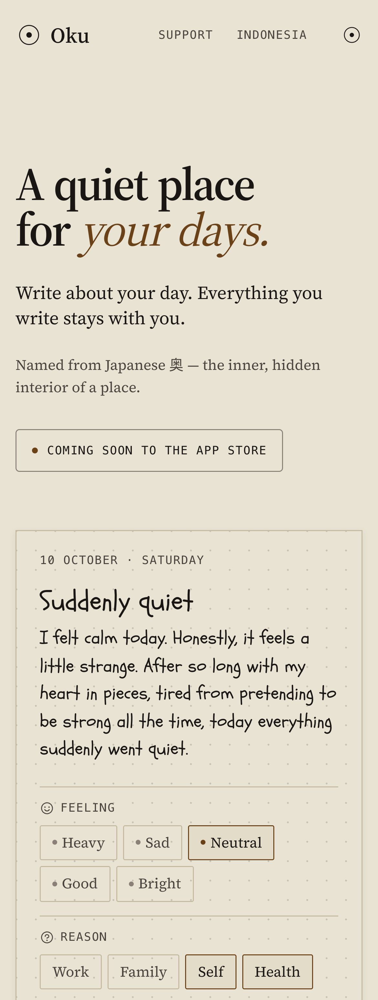
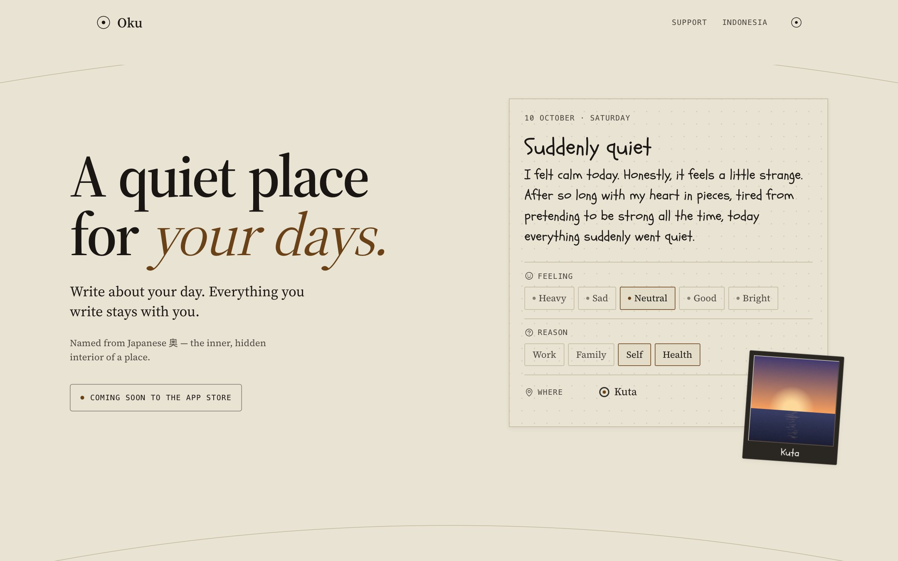
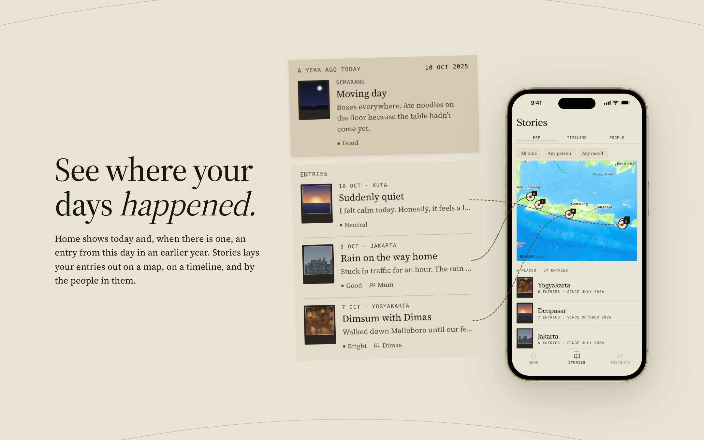
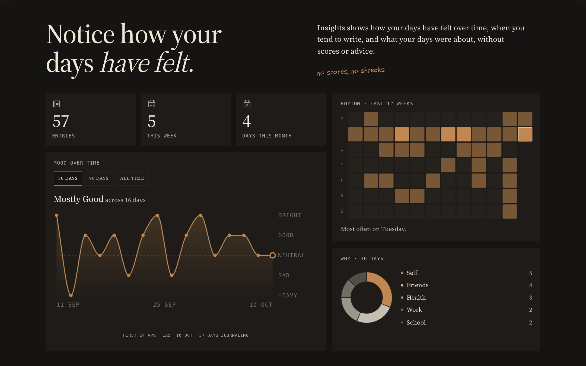
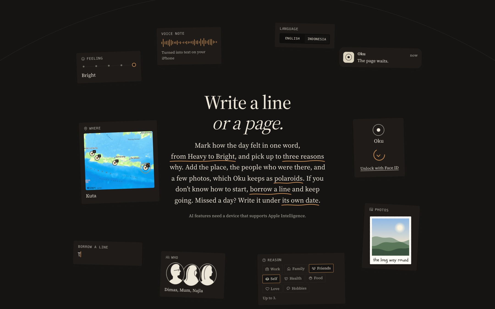

<div align="center">


# Oku

**A quiet place for your days. The website for a journal for iPhone.**

[Live site](https://oku-journal.pages.dev) · App Store: coming soon

</div>

Oku (奥) is named for the inner, hidden part of a place. You write a line or a page, mark how
the day felt, and look back on where your days happened. Everything stays on your iPhone.
This is the site that goes with the app: an introduction, the privacy policy, the terms, and
support.

<p align="center">
  
</p>

<table>
  <tr>
    <td width="50%" rowspan="4" valign="top"></td>
    <td width="50%"></td>
  </tr>
  <tr><td></td></tr>
  <tr><td></td></tr>
  <tr><td></td></tr>
</table>

---

## Built with

| Technology | What it does here |
|---|---|
| **Astro 7 + TypeScript** | Static pages and the small scripts behind them. |
| **CSS** | Styling and the scroll animations, with no framework. |
| **Fontsource** | Source Serif 4 and Schoolbell, bundled with the site. |
| **Phosphor Icons** | Icons, the same set as the app. |
| **sharp** | App screenshots resized to WebP. |
| **Cloudflare Pages** | Hosting. |

The demo photos are painted as SVG at build time, and the privacy policy, terms and FAQ are
synced from the app's repo. No analytics, no trackers, no outside requests.

## Run locally

```bash
npm install
npm run dev
```

---

<sub>© Muhammad Darrel Prawira. All rights reserved.</sub>
